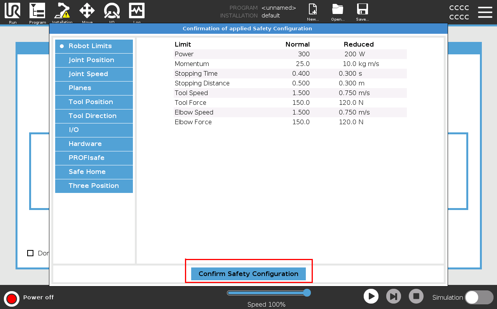
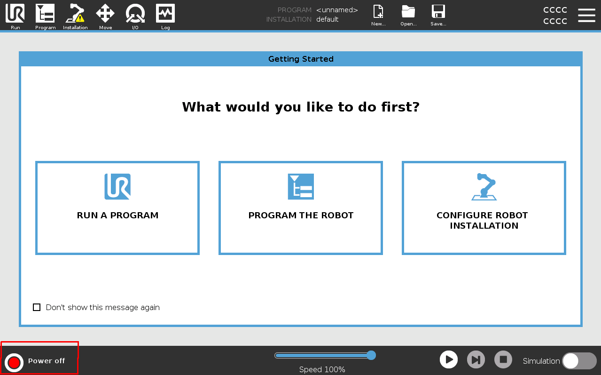
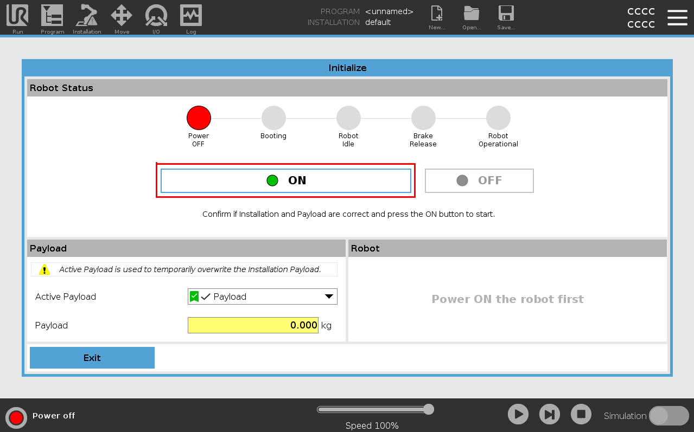
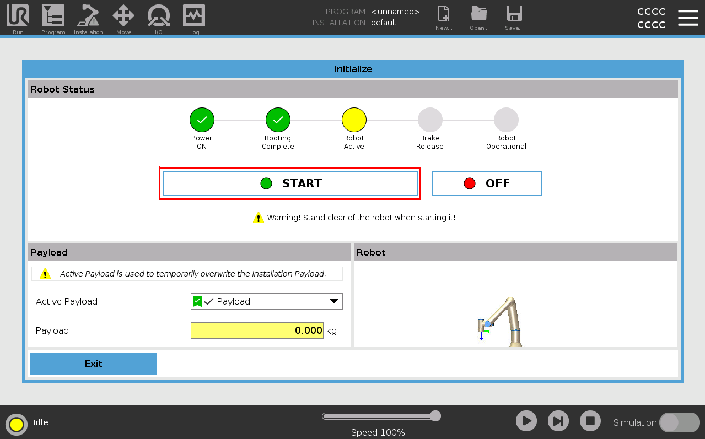
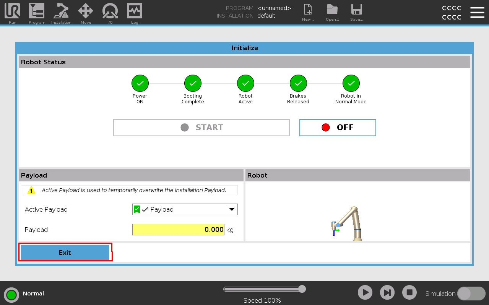

Environment Setup
*****************

This section explains how to prepare an environment for running ``ur_rtde`` examples.
Start with a simulator for safe local testing, then move to a physical robot once your setup is verified.

Choose the setup path that matches how you want to run examples:

- :ref:`Simulator setup <simulator-setup>`
- :ref:`Real robot setup <real-robot-setup>`

.. _simulator-setup:

Simulator setup
===============

The recommended first step is to run a Universal Robots simulator before connecting to a real robot.

Docker prerequisite
-------------------

The simulator examples below use Docker.
If Docker is not installed, follow the platform guide:

- Ubuntu: https://docs.docker.com/engine/install/ubuntu/
- Windows: `Docker Desktop for Windows <https://docs.docker.com/desktop/setup/install/windows-install/>`_
- macOS: `Docker Desktop for Mac <https://docs.docker.com/desktop/setup/install/mac-install/>`_

Run the simulator
----------------- 

1. Pull the Docker image:

   .. code-block:: bash

      docker pull universalrobots/ursim_e-series

2. Create a Docker network for the simulator:

   .. code-block:: bash

      docker network create --subnet=192.168.56.0/24 ursim_net

3. Start the simulator with a fixed IP address on that network.

   .. code-block:: bash

      docker run --rm -it --net ursim_net --ip 192.168.56.101 universalrobots/ursim_e-series

4. Optional: if you do not want to use the default UR5, add the ``ROBOT_MODEL`` environment variable.
   The available model options are ``UR3``, ``UR5``, ``UR7``, ``UR8LONG``, ``UR10``, ``UR12``, ``UR15``, ``UR16``, ``UR18``, ``UR20``, and ``UR30``.

   .. code-block:: bash

      docker run --rm -it --net ursim_net --ip 192.168.56.101 -e ROBOT_MODEL=UR10 universalrobots/ursim_e-series

For further information and options, see the official Universal Robots Docker Hub page:
https://hub.docker.com/r/universalrobots/ursim_e-series

For other simulator variants, use the corresponding image:

- CB-series: https://hub.docker.com/r/universalrobots/ursim_cb3
- Polyscope X: https://hub.docker.com/r/universalrobots/ursim_polyscopex

Once the simulator starts, the terminal output includes:

.. code-block:: bash

   IP address of the simulator

       192.168.56.101

   Access the robot's user interface through this URL:

       http://192.168.56.101:6080/vnc.html?host=192.168.56.101&port=6080

   Access the robot's user interface with a VNC application on this address:

       192.168.56.101:5900

   You can find documentation on how to use this container on dockerhub:

       https://hub.docker.com/r/universalrobots/ursim_e-series

   Press Ctrl-C to exit

The easiest way to view the simulator is to just use the URL link provided. Otherwise,
use a VNC client like Remmina on Ubuntu.

The following images show the typical sequence for confirming the safety configuration and starting the robot. In each image,
the action the user must perform is highlighted with a red box.

.. raw:: html

   

.. raw:: html

   

.. raw:: html

   

.. raw:: html

   

You are now ready to use the simulator and you can go to the 'Move' tab to visualize the robot. And 
continue to :ref:`Quick Start <quick_start>`

.. _real-robot-setup:

Real robot setup
================

Before running the examples on a physical robot, you must make sure the robot is reachable on the network
and that the required controller features are enabled.

You can use the ur_rtde interface in primarily two ways:

**1.** The RTDEControlInterface automatically uploads a script to the robot controller. (Requires the remote control feature to be enabled on the robot).

**2.** Install and use the External UR Cap on the robot controller see here, (Does not require remote control, but manual execution of the program on the controller).

**Option 1**. Does not require any installation on the robot, only configuration.

**Option 2**. Requires some extra flags in the
RTDEControlInterface constructor and installation of a the External Control UR Cap (This is the only option for PolyScopeX at the moment).
See the guide here :ref:`Use the ExternalControl UR Cap <external_control_urcap>`.

Option 1 - Remote control
-------------------------

.. tabs::

   .. group-tab:: PolyScope X

      **Enable services:**

      #. Go to the hamburger menu -> settings.
      #. Go to Security -> Services.
      #. Unlock the menu using the admin password.
      #. Enable the Primary Client Interface and Real-Time Data Exchange (RTDE) interfaces.
      #. Lock the menu and press exit.

      .. image:: https://docs.universal-robots.com/Universal_Robots_ROS2_Documentation/_images/services_polyscopex.png 
         :width: 600
         :alt: Screenshot from PolyScope X screen.

   .. group-tab:: PolyScope 5

      **Enable remote control:**

      #. Go to the hamburger menu -> settings.
      #. Go to System -> Remote control.
      #. Unlock the menu using the admin password, and enable Remote Control.
      #. Press exit.
      #. The robot can now be toggled between local and remote control in the upper right hand corner.

      .. image:: https://docs.universal-robots.com/Universal_Robots_ROS2_Documentation/_images/remote_control.png
         :width: 600
         :alt: Screenshot showing remote control toggle.

      **If using PolyScope 5.10 or greater: Enable services**

      #. Go to the hamburger menu -> settings.
      #. Go to Security -> Services.
      #. Unlock the menu using the admin password.
      #. Enable the Dashboard Server, Primary and Secondary Client Interface, Real-time Interface and Real-Time Data Exchange (RTDE) interfaces.
      #. Lock the menu and press exit.

      .. image:: https://docs.universal-robots.com/Universal_Robots_ROS2_Documentation/_images/services_polyscope5.png
            :width: 600
            :alt: Screenshot from PolyScope 5.xx services menu.

   .. group-tab:: CB3

      CB3 robots can directly be used with the ur_rtde. No special preparation is needed.

Option 2 - External Control UR Cap
----------------------------------

.. tabs::

   .. group-tab:: PolyScope X

      **Enable services:**

      #. Go to the hamburger menu -> settings.
      #. Go to Security -> Services.
      #. Unlock the menu using the admin password.
      #. Enable the Primary Client Interface and Secondary Client Interface, Real-time Interface and Real-Time Data Exchange (RTDE) interfaces.
      #. Lock the menu and press exit.

      .. image:: https://docs.universal-robots.com/Universal_Robots_ROS2_Documentation/_images/services_polyscopex.png 
         :width: 600
         :alt: Screenshot from PolyScope X screen.

   .. group-tab:: PolyScope 5

      **If using PolyScope 5.10 or greater: Enable services**

      #. Go to the hamburger menu -> settings.
      #. Go to Security -> Services.
      #. Unlock the menu using the admin password.
      #. Enable the Dashboard Server, Primary and Secondary Client Interface, Real-time Interface and Real-Time Data Exchange (RTDE) interfaces.
      #. Lock the menu and press exit.

      .. image:: https://docs.universal-robots.com/Universal_Robots_ROS2_Documentation/_images/services_polyscope5.png
            :width: 600
            :alt: Screenshot from PolyScope 5.xx services menu.

   .. group-tab:: CB3

      CB3 robots can directly be used with the ur_rtde. No special preparation is needed.

Recommended checks
------------------

1. Verify that the robot controller and the computer running ur_rtde are on the same network.
2. Confirm that the robot IP address is known and reachable from the host machine.
3. Make sure the robot is in remote control mode when using the default RTDE control workflow.
4. If you are using the External Control UR Cap, install it on the robot controller and configure
   it for the correct host IP address. If you have a firewall in place make sure it allows connection
   from the robot on the configured port.